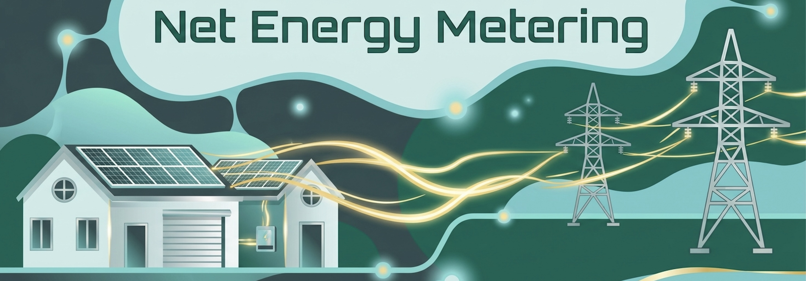

# BLOG: AI Prompt Investigator

## AI Prompt for Graphic Design

A header image depicting the theme of the blog makes the first impression.  Since I am not a graphic artist, I gave Gemini the following AI Prompt instructing it to generate the header image for a blog about net energy metering.

```
You are a graphic designer

Style:  Soft, flowing, space-age graphics

Palette:  #2f4f4f, #00664f, #c8e4e4, #6dc9c9, with bright gold highlights, and light metallic gray

Theme:  Net Energy Metering for residential solar panels sending electricity to grid

Size:  blogpost header for GitHub 1000 x 300 pixels

Using these parameters draw a blogpost header that incorporates the words in the theme
```
Gemini produced this graphic:



## Why write about Net Energy Metering (NEM)?

Take a look at this bill from Southern California Edison.  Notice anything confusing?


If you are curious, click on [Net Energy Metering](net_energy_metering.md) for the explanation.


