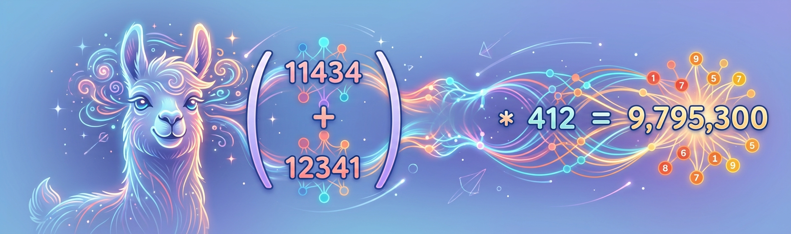

# Ollama Agentic Tool-Calling Loops

Some Ollama models have a thinking mode that exposes their thought processes.  Here's an example of the inner most thoughts of `qwen3:1.7b` when asked to solve a math problem:

```
Thinking:  Okay, let's see. The user is asking for the calculation of (11434 + 12341) multiplied by 412.
First, I need to break this down step by step.

Starting with the addition part: 11434 plus 12341. Let me add those numbers. 11434 + 12341... Let's do
the addition. 11434 + 12341. Adding the thousands: 11 + 12 is 23, then the hundreds: 4 + 3 is 7,
tens: 3 + 4 is 7, and units: 4 + 1 is 5. So combined, that's 23775? Wait, let me check again. 11434 + 12341.
Maybe I should add them properly. 11434 + 12341. Let's line them up:

  11434
+ 12341
-------
  23775

Yes, that's correct. So the sum is 23775.

Now, multiply that result by 412. So 23775 * 412. Hmm, that's a big number. Let me think about how
to compute this. Maybe break it down using the distributive property. 412 can be broken into
400 + 12. So, 23775 * 400 + 23775 * 12.

Calculating 23775 * 400:
23775 * 4 * 100.
23775 * 4 is 95100,
then times 100 is 9,510,000.

Then 23775 * 12:  Let's compute that.
23775 * 10 is 237750, and
23775 * 2 is 47550.
Adding those together: 237750 + 47550 = 285,300.

Now add the two results: 9,510,000 + 285,300 = 9,795,300.

Wait, let me verify that again. 9,510,000 plus 285,300.
Adding the thousands:
9,510,000 + 200,000 = 9,710,000.
Then add 85,300: 9,710,000 + 85,300 = 9,795,300.
Yes, that seems right.

So the final answer is 9,795,300. But let me check if there's a simpler way or
if I made any calculation errors. Alternatively, maybe use the functions provided.
The user provided functions for adding and multiplying. So perhaps I should
use those functions to compute each part.

First, add 11434 and 12341. Using the add function, the result would be 23775.
Then multiply that by 412 using the multiply function. So the steps would be:

1. Call add function with 11434 and 12341, get 23775.
2. Call multiply function with 23775 and 412, get 9795300.

Therefore, the answer is 9795300.

Content:  
Calling add with arguments {'a': 11434, 'b': 12341}
Result: 23775
Calling multiply with arguments {'a': 23775, 'b': 412}
Result: 9795300
Thinking:  Okay, let's see. The user asked for (11434 + 12341) * 412.
I first needed to add 11434 and 12341. Using the add function, that gave me 23775.
Then I had to multiply that result by 412. The multiply function was called with 23775 and 412,
resulting in 9795300. The user's final answer was 9795300, which matches my calculation.
So the correct answer is 9795300.

Content:  The result of (11,434 + 12,341) * 412 is calculated as follows:

1. **Addition**: 11,434 + 12,341 = 23,775
2. **Multiplication**: 23,775 * 412 = 9,795,300

Final Answer: 9,795,300

```

## Agent Loop

An agent loop allows the model to decide when to call tools.  Depending on the task, it may be necessary to tell the model that it can loop through multiple calls.  The model used in this example required 1.4 GB of space.

```
$ ollama pull qwen3:1.7b
pulling manifest 
pulling 3d0b790534fe: 100% ▕███████████████████████████████████████ ▏ 1.4 GB/1.4 GB   64 MB/s      0s
verifying sha256 digest 
writing manifest 
success 
```

In this example, the Python function `add` adds two integers. 

```
from ollama import chat, ChatResponse


def add(a: int, b: int) -> int:
  """Add two numbers"""
  """
  Args:
    a: The first number
    b: The second number

  Returns:
    The sum of the two numbers
  """
  return a + b
```

The Python function `multiply` multiplies two integers.

```
def multiply(a: int, b: int) -> int:
  """Multiply two numbers"""
  """
  Args:
    a: The first number
    b: The second number

  Returns:
    The product of the two numbers
  """
  return a * b
```

There are two available functions, `add` and `multiply`.

```
available_functions = {
  'add': add,
  'multiply': multiply,
}
```
A message is sent to the model by the user asking "What is the sum of 11434 + 12341, multiplied by 412?  

```
messages = [{'role': 'user', 'content': 'What is (11434+12341)*412?'}]
```

While processing, the model can call the available tools and output messages.  

```
while True:
    response: ChatResponse = chat(
        model='qwen3:1.7b',
        messages=messages,
        tools=[add, multiply],
        think=True,
    )
    messages.append(response.message)
    print("Thinking: ", response.message.thinking)
    print("Content: ", response.message.content)
    if response.message.tool_calls:
        for tc in response.message.tool_calls:
            if tc.function.name in available_functions:
                print(f"Calling {tc.function.name} with arguments {tc.function.arguments}")
                result = available_functions[tc.function.name](**tc.function.arguments)
                print(f"Result: {result}")
                # add the tool result to the messages
                messages.append({'role': 'tool', 'tool_name': tc.function.name, 'content': str(result)})
    else:
        # end the loop when there are no more tool calls
        break
  # continue the loop with the updated messages
```


**Reference** [Tool-calling](https://docs.ollama.com/capabilities/tool-calling)
