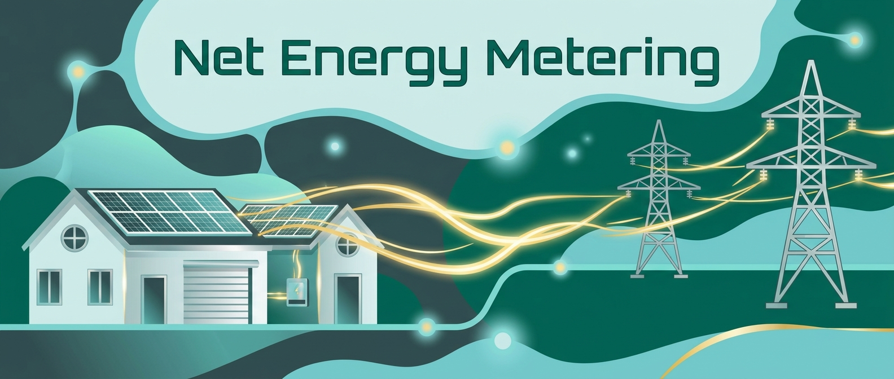

# BLOG: AI Prompt Investigator

## How can AI Prompts Help Write a Blog Post about Net Energy Metering


## AI Prompt

```
You are a graphic designer

Style:  IOTA style of soft, flowing, space-age graphics

Palette:  colors in a Southern California Edison invoice such as
#2f4f4f, #00664f, #c8e4e4, #6dc9c9, with bright gold highlights, and light metallic gray

Theme:  Net Energy Metering for residential solar panels sending electricity to grid

Size:  blogpost header for GitHub 1000 x 300 pixels

Using these parameters draw a blogpost header that incorporates the words in the theme
```

