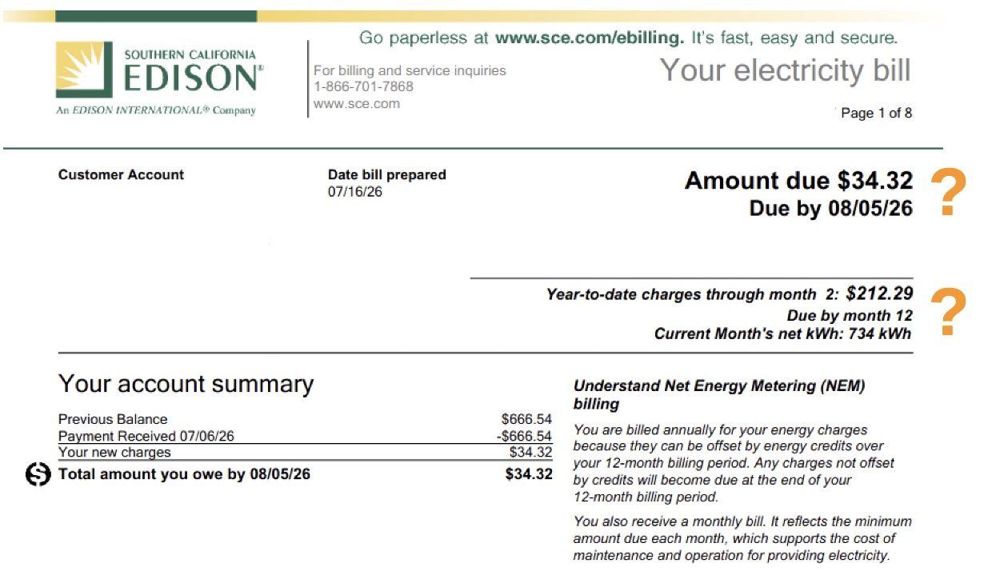
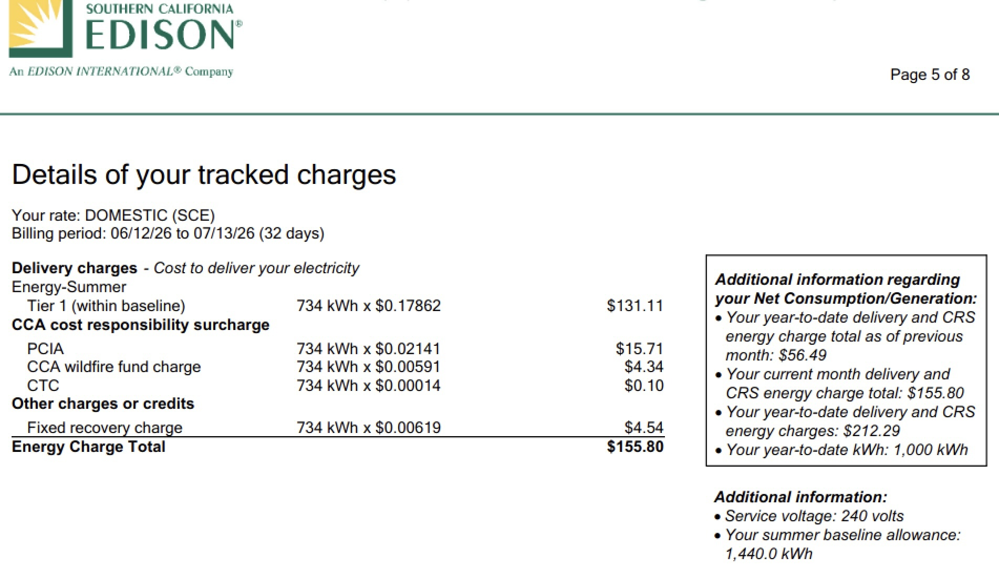
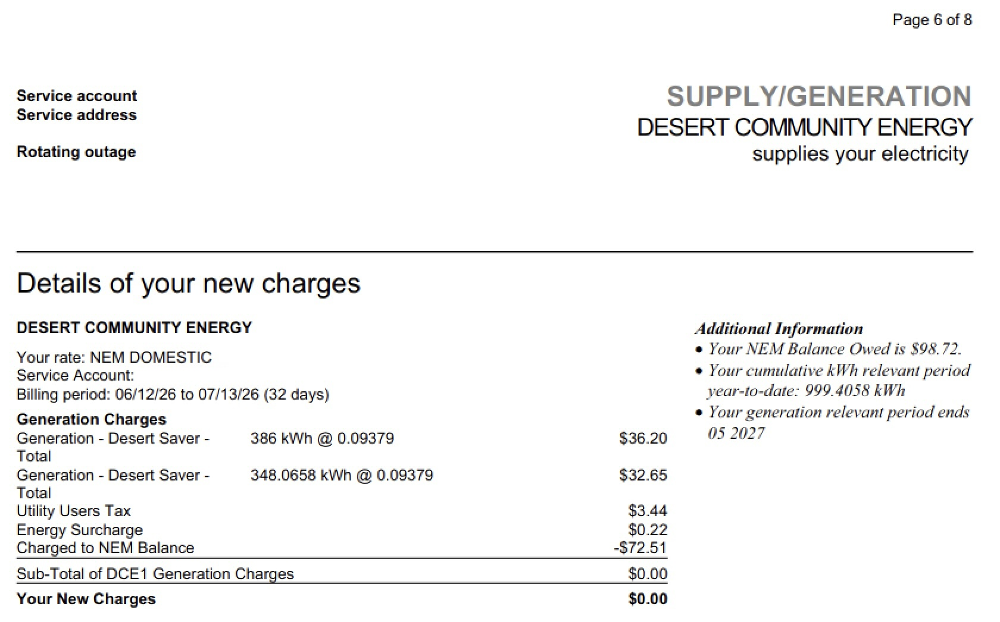
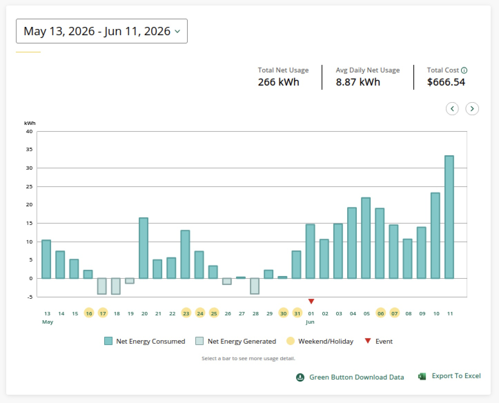
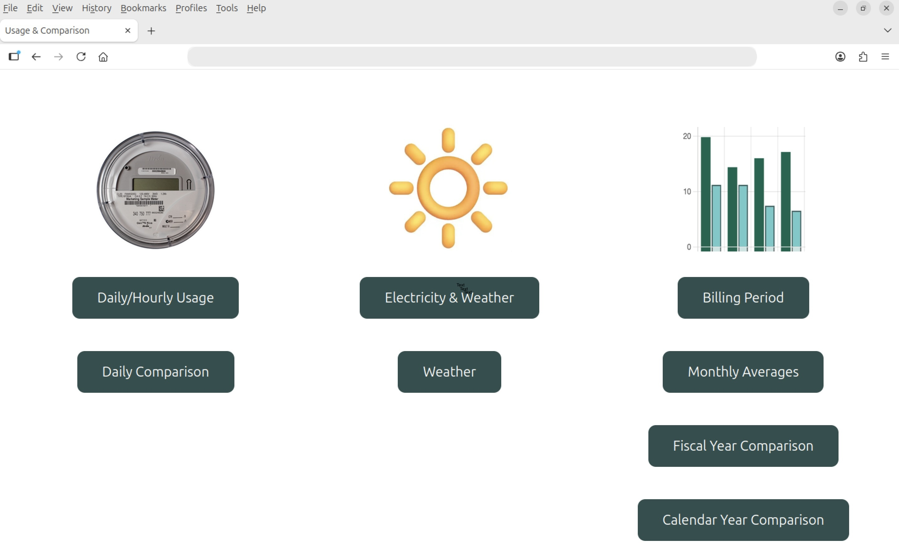
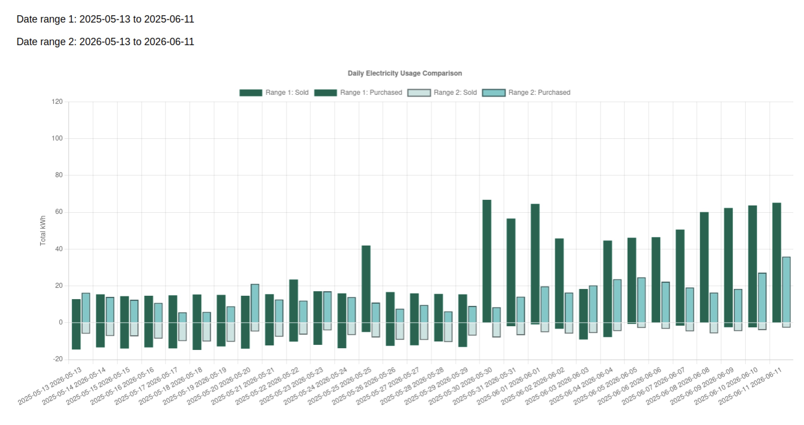
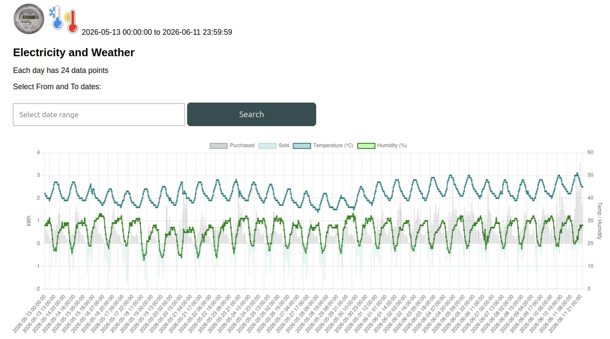
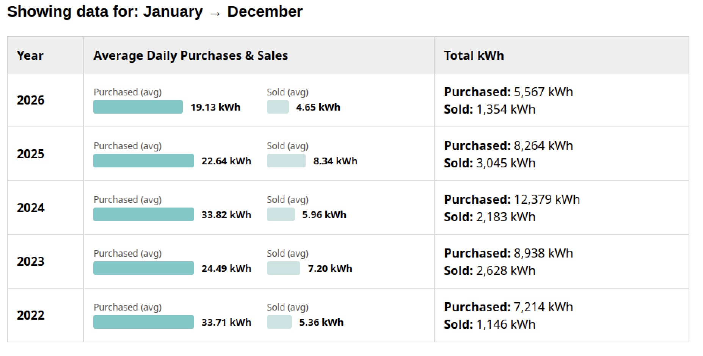

# BLOG: AI Prompt Investigator

## Why write about Net Energy Metering (NEM)?

Take a look at this bill from Southern California Edison.  Notice anything confusing?

---

---

The amount due is $34.32, but the year-to-date charges are $212.29.  Which amount should you pay?  

*Understand Net Energy Metering (NEM) billing* explains that you are billed at the end of the year for the net difference between the amount of electricity you purchased and the amount your solar panels generated and sold back.  But, there is more to the story.  Notice that the bill is 8 pages long.   Scrolling down you will find another section on page 5.

---

---

Page 5 details delivery charges, a total of $155.80 for the current month and $56.49 for the previous month resulting a $212.29 year-to-date total.

---

---

The next page shows supply generation by Desert Community Energy.  *Additional Information* on the right states that the NEM balance owed is $98.72, but on the left, the **Your New Charges** are zero.

In simple terms, Desert Community Energy generates wind and solar energy and Southern California Edison charges a fee to deliver it.
The year-to-date total for energy generation is $98.72 and the year-to-date total to delivery is $212.29.  The amount due each month is for SCE maintenance and operation.  At the end of the fiscal year, the total of both generation and delivery will be offset by the total electricity produced by your solar panels and sold back to SCE.  In order to budget for this yearly bill, keep track of the year-to-date totals.  SCE participates in the [Green Button initiative](https://www.energy.gov/data/green-button) and provides utility customers with easy and secure access to their energy usage information.  Notice the `Green button download data` at the bottom of the webpage.   

---

---

Clicking on the  `Green button download data` lets you download usage information in csv format.  Using AI Prompts for Python programming, MySql database design, and PHP website coding, Gemini generated code for a web app to analyze energy usage and sales.

---

---

Yearly comparison of energy usage reveals trends in energy conservation.

---

---

Installing a Raspberry Pi computer with a SenseHat temperature and humidity sensor to report hourly readings enriches the energy usage.  For example, the data clearly shows we begin using more energy as summer heats up and we use the air conditioner.

---

---

Keeping track of yearly energy consumption over the years helps budget.

---

---

