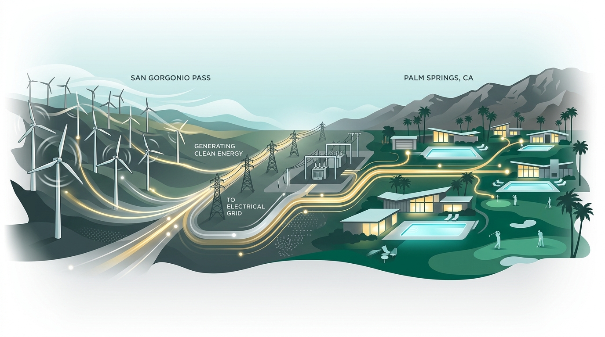
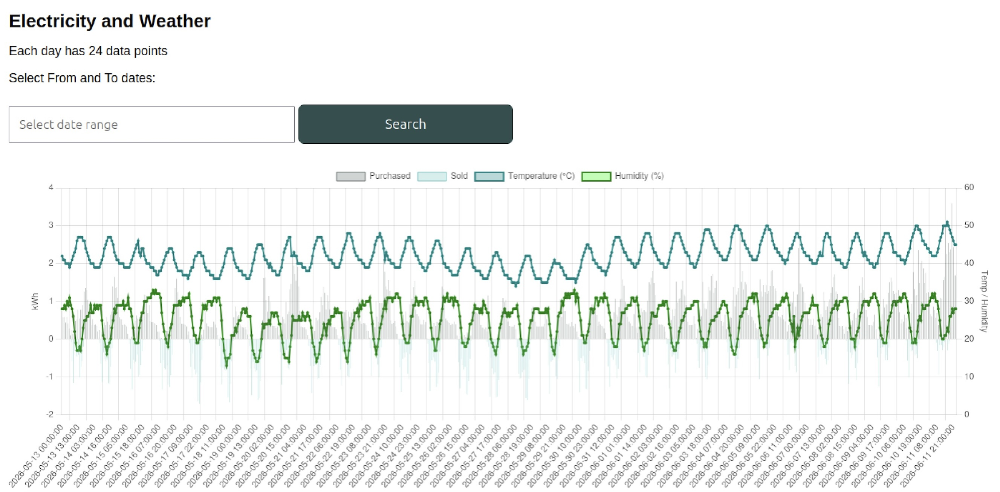

# BLOG: AI Prompt Investigator

## Why write about Net Energy Metering (NEM)?

Because reading a solar utility bill can be notoriously confusing.  Take a look at a typical bill from Southern California Edison (SCE). At first glance, you might notice something perplexing: the amount due is $34.32, yet the year-to-date charges show $212.29. Which amount are you actually supposed to pay?

---

---

## Decoding the Electric Bill

Under standard NEM billing, you are billed at the end of a 12-month cycle (called the "relevant period") for the net difference between the electricity you purchased and the excess power your solar panels generated and sold back to the grid. However, there is more to the story and the details are tucked deep inside an 8-page statement:

---

---

### Delivery Charges (Page 5) 

Details show delivery charges totaling $155.80 for the current month and $56.49 for the previous month, bringing the year-to-date delivery total to $212.29.

---

---

### Generation Charges (Page 6) 

Power supply is generated by a Community Choice Aggregator, [Desert Community Energy](https://desertcommunityenergy.org). The *Additional Information* section indicates an accrued NEM balance owed of $98.72, even though the **Your New Charges** column on the left reads $0.00.

## How It Works in Simple Terms

- **Generation** Desert Community Energy generates wind and solar power.

- **Delivery** and Southern California Edison charges a fee to deliver that power through their grid infrastructure.

The monthly amount due ($34.32) simply covers SCE's fixed monthly connection fees and grid maintenance. Meanwhile, the true energy charges are the year-to-date total for generation ($98.72) and delivery ($212.29) that accumulate in the background. At the end of the annual cycle, this total balance will be offset by the credit for all the solar power sent back to the grid.  To avoid surprises on your annual true-up bill, tracking your year-to-date totals throughout the year is essential.

## Tracking Energy Usage with AI and Custom Tools

SCE participates in the [Green Button initiative](https://www.energy.gov/data/green-button) and provides utility customers with easy and secure access to their energy usage information.  

---

---

Clicking on the  `Green button download data` lets you download usage information in csv format.  I downloaded our data and used AI-assisted prompts (leveraging Python, MySQL, and PHP) to build a custom web application for energy reporting.

---

---

Using the app's Daily Comparison feature, we discovered that in 2026 we purchased less electricity from the grid, but we also sold back less excess power.  Because our system lacks battery storage, timing is everything. We shifted our energy-heavy tasks to match peak sunlight hours:

- Cycling the pool pump during daytime hours.
- Running appliances like the washer, dryer, and dishwasher only when the sun is shining.
- Maintaining HVAC efficiency by keeping freon levels topped off and changing air filters monthly.

---

---

**Adding IoT Context:** Installing a Raspberry Pi equipped with a SenseHat sensor provides hourly temperature and humidity logs. Overlaying environmental sensor data onto energy consumption clearly illustrates how summer heatwaves drive increased air conditioner usage.

---

---

Keeping track of average daily usage over the years validates our energy saving behaviors and improves budgeting.

---

---

