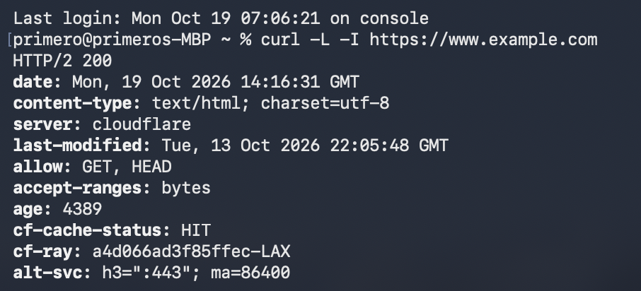
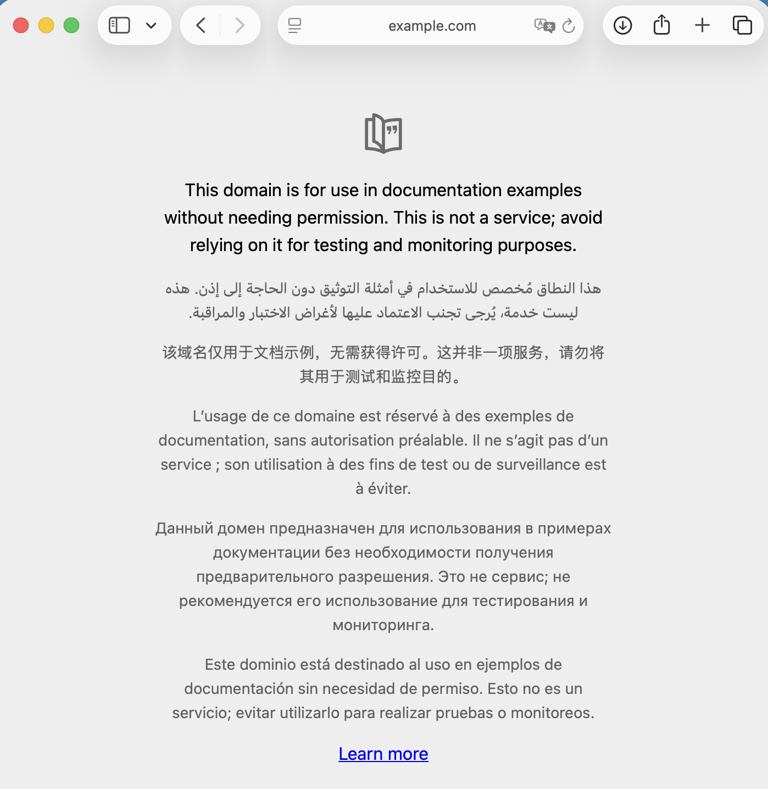
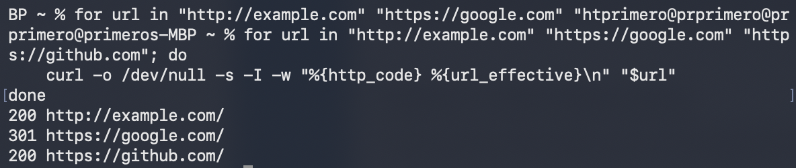
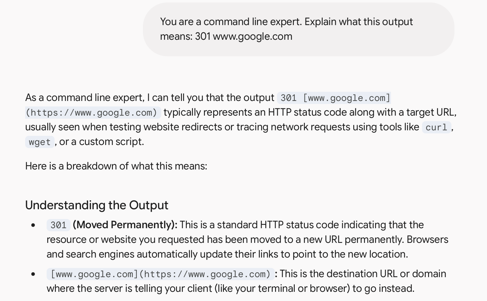

# BLOG:  AI Prompt Investigator

## Maintaining Web Links: Can AI uncover broken links in your website?

Technical writing is more than just writing.  Your readers expect 100% up-time.  Broken links are frustrating and in some cases, can even introduce security or compliance issues.  

When I was a content manager at Intel® I was responsible for external links in the tuning guides that I maintained.  Manually clicking over 700 links to ensure continual up-time was unrealistic and checking reports for each webpage was time-consuming.  Since, my content was publicly available, I wrote a Python script to automate checking and reporting broken links.  Without AI, I had to research StackOverflow and other articles in order to develop the script.  The work paid off because the script found quite a few broken links in the initial run.  I repaired these and scheduled the script to run daily, reporting any new link failures.  Now that AI has learned how to write code syntax, it can aid in developing a more generic tool to check for broken links on other public websites.  Gemini recommended using `curl`.

## Harnessing `curl` for Link Checks

`curl` is a command-line tool capable of retrieving data from a web server.  It can send HTTP requests, retrieve web page content, and report a status such as `200 OK` or `404 Not found`.  Gemini suggested this example:  

```bash
curl -L -I http://example.com
```

*  `-L` tells `curl` to follow any redirects
*  `-I` tells `curl` to display the HTTP headers including the status code
*  `http://example.com` is the link to a website often used for testing

## Test Drive the Link Checker

To run `curl` from your MacBook Pro, open Finder, go to Apps, and open a Terminal window.  Enter the `curl` command and press enter.



`HTTP/2 200` indicates that `curl` found `https://www.example.com`.   

To understand the technical output from `curl`, write a prompt telling Gemini to explain it.  Give Gemini a role, `You are a command line expert`.  Then, give Gemini a task, `Explain what this output means:`, paste the output.

**Explainer Prompt**
```
You are a command line expert.

Explain what this output means:

% curl -L -I https://www.example.com
HTTP/2 200 
date: Mon, 19 Oct 2026 14:47:44 GMT
content-type: text/html; charset=utf-8
server: cloudflare
last-modified: Tue, 13 Oct 2026 22:05:48 GMT
allow: GET, HEAD
accept-ranges: bytes
age: 6262
cf-cache-status: HIT
cf-ray: a4d094672bc153cb-LAX
alt-svc: h3=":443"; ma=86400
```

Gemini often provides a comprehensive response, as well as anticipating and responding to possible future questions.  Since Gemini decided to respond in markdown, I did a quick copy-and-paste so you can see the entire response.

**Gemini's Response**

Here is a breakdown of what each line of your `curl` header output means:

#### 1. The Status Line

* **`HTTP/2 200`**
* **`HTTP/2`**: The version of the HTTP protocol used for the communication.
* **`200`**: The standard HTTP status code for **OK**. This means the request was successful and the server returned the requested webpage.

#### 2. Response Metadata & Server Details

* **`date: Mon, 19 Oct 2026 14:47:44 GMT`**: The exact date and time the server generated this response.
* **`content-type: text/html; charset=utf-8`**: Tells your browser or script that the response is an HTML document encoded in UTF-8 (standard web text).
* **`server: cloudflare`**: Indicates the website is protected or hosted behind Cloudflare's content delivery network (CDN).
* **`last-modified: Tue, 13 Oct 2026 22:05:48 GMT`**: The date and time the webpage content was last updated on the server.
* **`allow: GET, HEAD`**: The HTTP methods supported by this specific endpoint (retrieving content and fetching headers).
* **`accept-ranges: bytes`**: Indicates that the server supports partial content requests (useful for downloading large files in chunks).

#### 3. Cloudflare & Performance Headers

* **`age: 6262`**: The number of seconds the response has been sitting in Cloudflare's cache.
* **`cf-cache-status: HIT`**: A very helpful indicator! **`HIT`** means the page was served directly from Cloudflare's edge cache rather than hitting the origin server, which makes the site load much faster.
* **`cf-ray: a4d094672bc153cb-LAX`**: Cloudflare's unique tracking ID for this specific request, routing through their Los Angeles (`LAX`) data center edge.
* **`alt-svc: h3=":443"; ma=86400`**: Advertises that HTTP/3 (`h3`) is available on port 443 for future faster connections.


## Verify the AI Prompt Response

Google adds this disclaimer, *"Gemini isn’t human. It can make mistakes, so double-check it."*  When asked about prompt accuracy, Gemini explains further, *"AI-generated responses are provided for informational and educational purposes only. AI models may occasionally produce inaccurate, incomplete, or outdated information."*

Fact-checking a long-winded response takes time.  In this example, the first part of the response `1. The Status Line` reveals the status `HTTP/2 200` meaning "OK, I found the webpage associated with the link".  This is easy to verify, simply enter "www.example.com" into a browser.



The additional information in sections 2 and 3 may be interesting, but fact-checking all this data is not necessary.  How much time you spend verifying an AI Prompt response depends on your environment and your needs. 


## Automate Checking Multiple Links

If you want to check the HTTP status codes for more than one link, use a loop:

```
for url in "http://example.com" "https://google.com" "https://github.com"; do
    curl -o /dev/null -s -I -w "%{http_code} %{url_effective}\n" "$url"
done
```



Notice that `curl` returned a status code of 301 when attempting to access `www.google.com`.  Use the **Explainer Prompt** to find out what 301 means.




## Recap

This example introduced how AI can co-author code to check the status of links.  Some links are protected by security features that cause `curl` to output response codes other than 200.  The **Explainer Prompt** can be used to help decipher these codes.  


