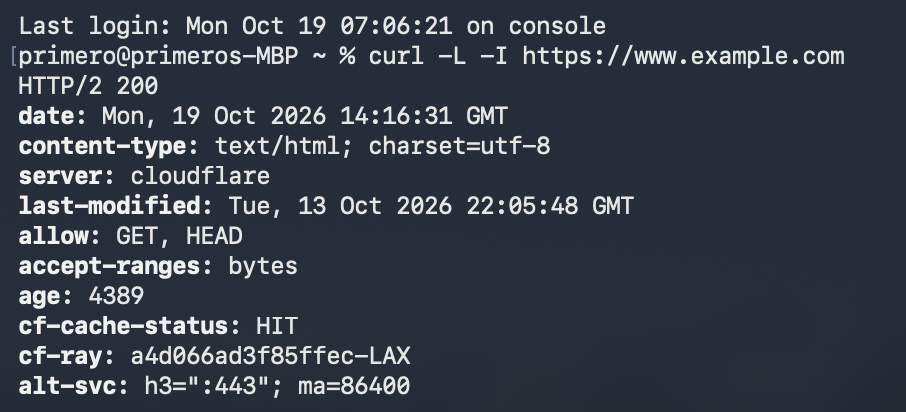

# Blog

## Can AI uncover link rot on your website?
As a technical documentation manager, ensuring that readers can easily navigate your content is important.  Broken links can frustrate users, degrade the overall user experience, and in some cases, even introduce security or compliance issues.  

When I was a content manager at Intel® I was responsible for maintaining over 700 external links!  Manually clicking 700 links to ensure continual up-time is a daunting task.  It took me some time to develop an automated system for checking and reporting broken links.  This blog post explores how AI can help.

## The Reality of AI Capabilities

When asked, Google Gemini confirmed, *"I cannot directly crawl webpages or run automated link-checking tools to test whether hyperlinks are broken or active in real time. I can assist in writing scripts to automate link checking while explaining errors and output from these scripts.  Here's one example using a command line tool called `curl`"*

## Harnessing `curl` for Link Checks

`curl` is a command-line tool capable of retrieving data from a web server.  It can send HTTP requests, retrieve web page content, and report a status such as `200 OK` or `404 Not found`.  Gemini suggested this example:  

```bash
curl -L -I http://example.com
```

*  `-L` tells `curl` to follow any redirects
*  `-I` tells `curl` to display the HTTP headers including the status code
*  `http://example.com` is the URL of the website to check for broken links

## Take a Test Drive

To run curl from your MacBook Pro, open Finder, go to Apps, and open a Terminal window.  Enter the curl command and press enter.



`HTTP/2 200` indicates that curl found `https://www.example.com`.   

### Technical Explainer AI Prompt

To understand the technical output from curl, write a prompt directing Gemini to explain it.  Tell Gemini what role it is undertaking, `You are a command line expert`, then direct Gemini to perform a task, `Explain what this output means...`

```
You are a command line expert.

Explain what this output means:

% curl -L -I https://www.example.com
HTTP/2 200 
date: Mon, 19 Oct 2026 14:47:44 GMT
content-type: text/html; charset=utf-8
server: cloudflare
last-modified: Tue, 13 Oct 2026 22:05:48 GMT
allow: GET, HEAD
accept-ranges: bytes
age: 6262
cf-cache-status: HIT
cf-ray: a4d094672bc153cb-LAX
alt-svc: h3=":443"; ma=86400

```

Gemini often anticipates future questions and provides a comprehensive response, in this case, the response was in markdown format.

### Gemini Explanation

Here is a breakdown of what each line of your `curl` header output means:

#### 1. The Status Line

* **`HTTP/2 200`**
* **`HTTP/2`**: The version of the HTTP protocol used for the communication.
* **`200`**: The standard HTTP status code for **OK**. This means the request was successful and the server returned the requested webpage.

---

#### 2. Response Metadata & Server Details

* **`date: Mon, 19 Oct 2026 14:47:44 GMT`**: The exact date and time the server generated this response.
* **`content-type: text/html; charset=utf-8`**: Tells your browser or script that the response is an HTML document encoded in UTF-8 (standard web text).
* **`server: cloudflare`**: Indicates the website is protected or hosted behind Cloudflare's content delivery network (CDN).
* **`last-modified: Tue, 13 Oct 2026 22:05:48 GMT`**: The date and time the webpage content was last updated on the server.
* **`allow: GET, HEAD`**: The HTTP methods supported by this specific endpoint (retrieving content and fetching headers).
* **`accept-ranges: bytes`**: Indicates that the server supports partial content requests (useful for downloading large files in chunks).

---

#### 3. Cloudflare & Performance Headers

* **`age: 6262`**: The number of seconds the response has been sitting in Cloudflare's cache.
* **`cf-cache-status: HIT`**: A very helpful indicator! **`HIT`** means the page was served directly from Cloudflare's edge cache rather than hitting the origin server, which makes the site load much faster.
* **`cf-ray: a4d094672bc153cb-LAX`**: Cloudflare's unique tracking ID for this specific request, routing through their Los Angeles (`LAX`) data center edge.
* **`alt-svc: h3=":443"; ma=86400`**: Advertises that HTTP/3 (`h3`) is available on port 443 for future faster connections.


### AI Prompt Response Verification

Google adds this disclaimer to responses, *"Gemini isn’t human. It can make mistakes, so double-check it."*

When asked, Gemini explains further, *"AI-generated responses are provided for informational and educational purposes only. AI models may occasionally produce inaccurate, incomplete, or outdated information."*

How much time you spend verifying an AI Prompt response depends on what part of the response you used and your environment.  In the example, you may only use information from `1. The Status Line`.  If you are checking exposed links without extra security features, then looking for HTTP/2 200 is good enough.  However, many sites have security that prevents curl from scraping their content.  


