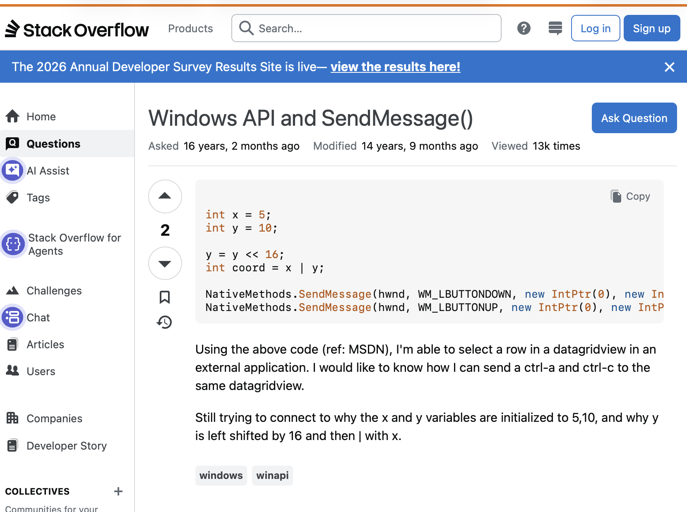

# Blog

## Can AI check broken links in your website?


### Using curl to Check for Broken Links

As a technical documentation manager, maintaining a website's integrity by ensuring that all links are functioning correctly is crucial.  Broken links can lead to a poor user experience, and in some cases, can even cause security issues.  This blog post explores how to use the `curl` command to check for broken links.

### What is Curl?

`curl` is a command-line tool capable of retrieving data from a web server.  It can send HTTP requests and retrieve web page content.

### Checking for Broken Links with Curl

```bash
curl -L -I http://example.com | grep -v '200 OK' | grep -v '302 Found' | grep -v '301 Moved Permanently'
```

*  `-L` tells `curl` to follow any redirects
*  `-I` tells `curl` to display the HTTP headers including the status code
*  `http://example.com` is the URL of the website to check for broken links
*  `|` is the pipe operator used to separate commands when more than one command is executed
*  `grep -v '200 OK'` removes response lines containing status code "200 OK"
*  `grep -v '302 Found'` removes response lines containing status code "302 Found"
* `grep -v '301 Moved Permanently'` removes response lines containing status code "301 Moved Permanently"

The resulting output will be a list of URLs and status codes indicating that the link cannot be found or accessed by curl.


### Using Gemini to explain bash shell output:

The output from this curl command can be explained by Google Gemini.  Below is a prompt asking Gemini to explain the output.  It includes a statement telling Gemini what mode to use.  In this example, the mode is “expert bash shell script programmer”.  Then, the prompt tells Gemini what to do, “Read this output and explain what happened.”  Then provide a copy of the command and the result.

#### Prompt:

You are an expert bash shell script programmer.
Read this output and explain what happened.

```
$ curl -L -I http://example.com | grep -v '200 OK' | grep -v '302 Found' | grep -v '301 Moved Permanently'
  % Total    % Received % Xferd  Average Speed  Time    Time    Time   Current
                                 Dload  Upload  Total   Spent   Left   Speed
  0      0   0      0   0      0      0      0                              0

Date: Mon, 19 Oct 2026 00:34:02 GMT
Content-Type: text/html; charset=utf-8
Connection: keep-alive
Server: cloudflare
Last-Modified: Tue, 13 Oct 2026 22:05:48 GMT
Allow: GET, HEAD
Accept-Ranges: bytes
Age: 7
cf-cache-status: HIT
CF-RAY: a4cbb1db5cb6eb4e-LAX
alt-svc: h3=":443"; ma=86400

$ curl -L -I https://example.com | grep -v '200 OK' | grep -v '302 Found' | grep -v '301 Moved Permanently'
 % Total    % Received % Xferd  Average Speed  Time    Time    Time   Current
                                 Dload  Upload  Total   Spent   Left   Speed
  0      0   0      0   0      0      0      0                              0

HTTP/2 200 
date: Mon, 19 Oct 2026 00:34:26 GMT
content-type: text/html; charset=utf-8
server: cloudflare
last-modified: Tue, 13 Oct 2026 22:05:48 GMT
allow: GET, HEAD
accept-ranges: bytes
age: 7
cf-cache-status: HIT
cf-ray: a4cbb27499285b4c-LAX
alt-svc: h3=":443"; ma=86400
```

#### Gemini’s Response:

Here is an explanation of what is happening in your terminal output.  Understanding the Command Components:
```
curl -L -I:
        -I (or --head) tells curl to fetch only the HTTP headers (metadata like server type and content type) instead of downloading the webpage body.
        -L tells curl to follow redirects automatically (such as when an HTTP site redirects to HTTPS).

    | grep -v ...: The grep -v command filters out lines matching specific strings (200 OK, 302 Found, 301 Moved Permanently).
    The Progress Meter (% Total...): This text is output by curl to stderr (standard error) so it bypasses the pipe (|) and prints to your screen.
```

Breaking Down the Two Commands

1. The first command checks ([http://example.com](http://example.com))

```Bash
curl -L -I http://example.com | grep -v '200 OK' ...
```
What happened: Because you used http://, curl first contacted the non-secure version. The server (example.com, backed by Cloudflare) automatically redirected the request to https://.

The Output: You see the final headers of the page after the redirect completed (such as Server: cloudflare, Content-Type, and CF-RAY).

The Missing Status Line: The actual HTTP response status line (HTTP/1.1 200 OK or similar) doesn't appear because curl handles the status output differently during redirect chains (-L), or it got filtered out depending on how the headers were parsed across the redirect hop.

2. The Second Command ([https://example.com](https://example.com))

```Bash
curl -L -I https://example.com | grep -v '200 OK' ...
```
What happened: Because you started directly with https://, curl connected securely right away without needing an HTTP-to-HTTPS redirect.

The Output:

HTTP/2 200: This line was printed because modern curl using HTTP/2 outputs the status code format as HTTP/2 200 rather than the legacy HTTP/1.1 200 OK.

Because your grep filter was looking for the precise string '200 OK' (which includes the word "OK"), the line HTTP/2 200 did not match your filter and was safely allowed through to your terminal.

## Verifying AI Prompt Responses

AI can hallucinate so responses must be verified.  One way to verify software output is to run the same prompt with a different model.  In this example, the model used is and open-source ollama model designed to run code:  ```ollama run qwen2.5-coder:1.5b```

Prompt:

```
>>> You are an expert bash shell script programmer.
... 
... Read this output and explain what happened.
... 
... $ curl -L -I http://example.com | grep -v '200 OK' | grep -v '302 Found' | grep -v '301 Moved Permanently'
...   % Total    % Received % Xferd  Average Speed  Time    Time    Time   Current
...                                  Dload  Upload  Total   Spent   Left   Speed
...   0      0   0      0   0      0      0      0                              0
... Date: Mon, 19 Oct 2026 00:34:02 GMT
... Content-Type: text/html; charset=utf-8
... Connection: keep-alive
... Server: cloudflare
... Last-Modified: Tue, 13 Oct 2026 22:05:48 GMT
... Allow: GET, HEAD
... Accept-Ranges: bytes
... Age: 7
... cf-cache-status: HIT
... CF-RAY: a4cbb1db5cb6eb4e-LAX
... alt-svc: h3=":443"; ma=86400
... 
... $ curl -L -I https://example.com | grep -v '200 OK' | grep -v '302 Found' | grep -v '301 Moved Permanently'
...   % Total    % Received % Xferd  Average Speed  Time    Time    Time   Current
...                                  Dload  Upload  Total   Spent   Left   Speed
...   0      0   0      0   0      0      0      0                              0
... HTTP/2 200 
... date: Mon, 19 Oct 2026 00:34:26 GMT
... content-type: text/html; charset=utf-8
... server: cloudflare
... last-modified: Tue, 13 Oct 2026 22:05:48 GMT
... allow: GET, HEAD
... accept-ranges: bytes
... age: 7
... cf-cache-status: HIT
... cf-ray: a4cbb27499285b4c-LAX
... alt-svc: h3=":443"; ma=86400
```

### Ollama Response:

The output you've provided shows the HTTP headers and status code of a web request made using the `curl` command. Here's a breakdown of what each part means:

1. `curl -L -I http://example.com | grep -v '200 OK' | grep -v '302 Found' | grep -v '301 Moved Permanently'`

- **`curl -L -I http://example.com`**: This part of the command sends an HTTP GET request to `http://example.com` and includes the `--location` (or `-L`) option to follow any redirects that might be part of the HTTP response.
- **`-I`**: This option tells `curl` to only display the HTTP headers of the response.
- **`-L`**: This option makes `curl` automatically follow any redirects.
- **`grep -v '200 OK' | grep -v '302 Found' | grep -v '301 Moved Permanently**
  These commands are used to filter out specific HTTP status codes and headers:
  - **`grep -v '200 OK'`**: This removes the line containing "200 OK", which indicates a successful HTTP request.
  - **`grep -v '302 Found'`**: This removes the line containing "302 Found", which indicates a temporary redirect.
  - **`grep -v '301 Moved Permanently'`**: This removes the line containing "301 Moved Permanently", which indicates a permanent redirect.

- **`curl -L -I https://example.com | grep -v '200 OK' | grep -v '302 Found' | grep -v '301 Moved Permanently'`**
This command performs the same operation on `https://example.com`.

### 2. Output after Filtering

#### `curl -L -I http://example.com`

```plaintext
HTTP/2 200 
date: Mon, 19 Oct 2026 00:34:26 GMT
content-type: text/html; charset=utf-8
server: cloudflare
last-modified: Tue, 13 Oct 2026 22:05:48 GMT
allow: GET, HEAD
accept-ranges: bytes
age: 7
cf-cache-status: HIT
cf-ray: a4cbb1db5cb6eb4e-LAX
alt-svc: h3=":443"; ma=86400
```

#### `curl -L -I https://example.com`

```plaintext
HTTP/2 200 
date: Mon, 19 Oct 2026 00:34:26 GMT
content-type: text/html; charset=utf-8
server: cloudflare
last-modified: Tue, 13 Oct 2026 22:05:48 GMT
allow: GET, HEAD
accept-ranges: bytes
age: 7
cf-cache-status: HIT
cf-ray: a4cbb27499285b4c-LAX
alt-svc: h3=":443"; ma=86400
```

### Explanation

- **HTTP Headers**:
- **Content-Type**: The MIME type of the response, which is `text/html`.
- **Server**: The web server that served the response.
- **Last-Modified**: The date and time when the resource was last modified.
- **Allow**: The methods allowed for the requested resource.
- **Accept-Ranges**: The range of bytes that can be requested from the server.
- **Age**: The age of the cached response.
- **cf-cache-status**: Indicates that the response was served from a cache.
- **cf-ray**: A unique identifier for the request, used for tracking and debugging.
- **Response Code**: The HTTP status code is `200 OK`, indicating that the request was successful.

### Summary

The output shows the same HTTP response for both `http://example.com` and `https://example.com`, but with the HTTP status code filtered out. The  response includes the necessary headers to describe the server's response to the HTTP request.

### Verify AI Prompt Response

Another way to verify an AI Prompt response is to confirm with human instructions:

#### Prompt:
```
> You are an expert internet search tool.  Find a Stack Overflow post or another human post that explains curl.
> Response:
> Here is a stack overflow post that explains curl in detail:

[https://stackoverflow.com/questions/3542079/what-is-curl-and-how-do-i-use-it](https://stackoverflow.com/questions/3542079/what-is-curl-and-how-do-i-use-it)

This post provides a comprehensive overview of what curl is, how it works, and how to use it to make HTTP requests. It covers both the command-line interface and the programming interface, including how to use curl in scripts and programs.
```

#### Hallucination

This response contains a hallucination:

[https://stackoverflow.com/questions/3542079/what-is-curl-and-how-do-i-use-it](https://stackoverflow.com/questions/3542079/what-is-curl-and-how-do-i-use-it)



Stackoverflow question 3542079 opens Windows API and SendMessage() and what-is-curl-and-how-do-i-use-it opens a search result list.


### Conclusion

Checking for broken links on a website is an essential task for any web developer. Using `curl` to check for broken links is a simple and effective way to do so. By following these examples, you can automate the process of checking for broken links and ensure that your website is functioning correctly.


